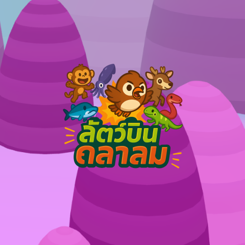
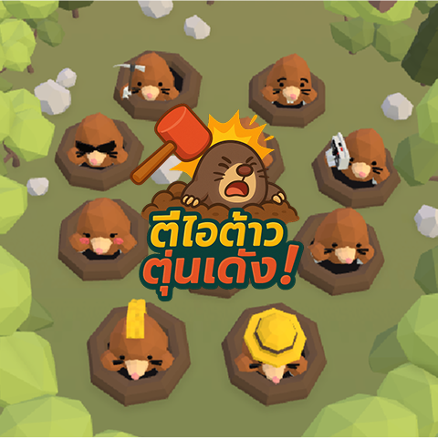
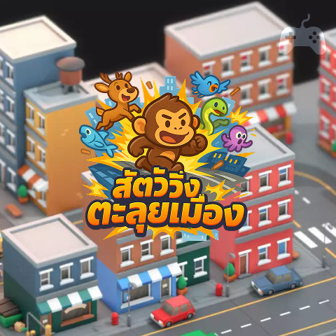
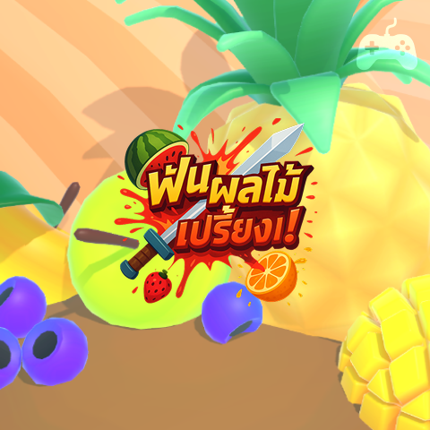
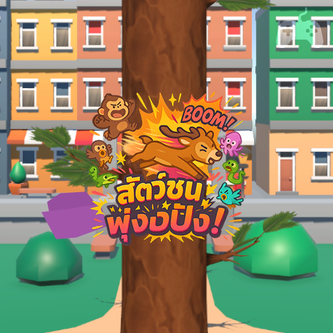
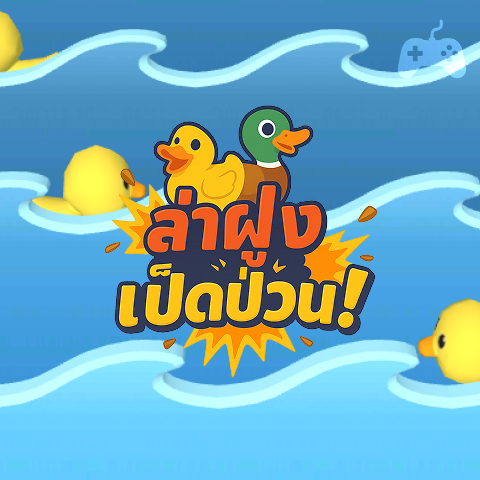

# MasqueGame

เกมมือถือสำหรับ myAIS WebView รวม 7 เกม เล่นฟรีหรืออัปเกรดเป็น Masque Pass เพื่อเล่นไม่จำกัดและปลดล็อกสิทธิ์เข้าร่วม Ranking

<p align="center">
	
</p>

<p align="center"><strong>Svelte 5 · TypeScript · Vite · Tailwind CSS 4</strong><br />Mobile-first · Static SPA · No backend</p>

## เกมในแคตตาล็อก

| **ARCADE** | **REACTION** | **RUNNER** |
|:---:|:---:|:---:|
| <br /><strong>สัตว์บินถลาลม</strong><br />[เล่นเกม](https://masque-lab.adldigitalservice.com/myroom/bird/) | <br /><strong>ตีไอต้าวตุ่นเด้ง</strong><br />[เล่นเกม](https://masque-lab.adldigitalservice.com/myroom/mole-v3/) | <br /><strong>สัตว์วิ่งตะลุยเมือง</strong><br />[เล่นเกม](https://masque-lab.adldigitalservice.com/myroom/game/run/) |
| **ACTION** | **ARCADE · DEER EDITION** | **SHOOTER** |
| <br /><strong>ฟันผลไม้เปรี้ยง</strong><br />[เล่นเกม](https://masque-lab.adldigitalservice.com/myroom/fruitninja/) | <br /><strong>สัตว์ชนพุ่งปังปัง</strong><br />[เล่นเกม](https://masque-lab.adldigitalservice.com/myroom/game/timberdear/) | <br /><strong>ล่าฝุงเป็ดป่วน</strong><br />[เล่นเกม](https://masque-lab.adldigitalservice.com/myroom/shooting-duck/) |
| **MEMORY** |  |  |
| **สัตว์จับคู่สู้สุดใจ**<br />จับคู่ภาพสัตว์ให้ครบทุกคู่<br />[เล่นเกม](https://masque-lab.adldigitalservice.com/mygame/memonrycard/) |  |  |

> ภาพปกอ้างอิงจาก `public/images/` และเกม Timber เป็นเกมสไตล์ Timberman ที่เปลี่ยนตัวละครเป็นกวาง
>
> เกมสัตว์จับคู่สู้สุดใจยังไม่มีภาพปกใน assets จึงใช้ไอคอนการ์ดจับคู่แทน

## ฟีเจอร์

- **Game Center** แสดงสถานะ Free Play หรือ Pass Active, Player ID, Level, AIS Points จำลอง และการ์ดเกม
- **Masque Pass** มี Daily Pass (1 Point / 1 วัน) และ Weekly Pass (5 Points / 7 วัน) พร้อมต่ออายุจากเวลาหมดอายุเดิม
- **Leaderboard** เลือกเกมและช่วงเวลาได้ ข้อมูลจัดอันดับแยกตามเกม
- **Game Player** เปิดเกมผ่าน iframe มี loading state, ทางเลือกเปิดแท็บใหม่ และปุ่มกลับหน้า Home
- **Free Play** นับเวลาเล่นรวมทุกเกมวันละ 60 นาที และหยุดนับเมื่อออกจากเกมหรือซ่อนหน้าเว็บ
- **Mobile-first** รองรับหน้าจอ 320–430px, safe area, bottom navigation และหน้าจอแนวนอน

## เริ่มพัฒนา

ต้องมี Node.js และ npm ติดตั้งไว้แล้ว

```sh
npm install
npm run dev
npm run check
npm run build
```

Vite dev server ใช้ base path `/maque-center/` เช่น `http://localhost:5173/maque-center/` เมื่อ build สำเร็จ ไฟล์สำหรับ deploy จะอยู่ใน `dist/`.

## Deploy

นำ **เนื้อหาภายใน `dist/`** ไปวางใน directory บนเว็บเซิร์ฟเวอร์ที่ให้บริการ URL นี้:

**https://masque-lab.adldigitalservice.com/maque-center/**

Build กำหนด asset base เป็น `/maque-center/` แล้ว และใช้ hash navigation เพื่อให้เปิดแต่ละหน้าใน static hosting ได้โดยไม่ต้องตั้ง backend routing

## โครงสร้างหลัก

```text
src/
├── App.svelte
├── app.css
├── main.ts
└── lib/
		├── components/   # Header, navigation, game/pass/ranking UI
		├── data/         # Game catalog และ mock rankings
		├── services/     # Player, pass และ ranking logic
		└── types/        # TypeScript models
public/images/        # ภาพปกเกม
```

## ขอบเขต Prototype

ชื่อผู้เล่น, Player ID, AIS Points, Pass expiration และเวลาเล่นฟรีเก็บใน `localStorage` บน browser เท่านั้น Ranking เป็น mock data ส่วนคะแนนไม่ได้รับหรือยืนยันจาก iframe และไม่มีการเชื่อมต่อ AIS จริง ดังนั้นข้อมูลเหล่านี้ใช้ทดสอบ UI/UX เท่านั้น ไม่สามารถยืนยันสิทธิ์ ป้องกันการแก้ไขข้อมูล หรือทำธุรกรรมจริงได้